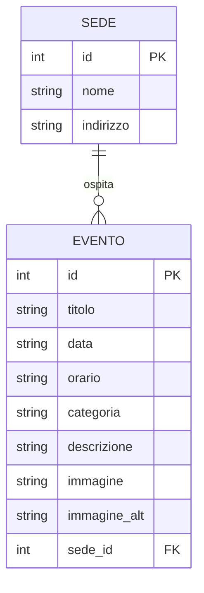

# Scheda dati — Segnale, festival di design

Dati del sito, contenuti in due file JSON nella cartella `dati/`:

- `eventi.json` → entità **Evento**
- `sedi.json` → entità **Sede**

Festival, sedi ed eventi sono inventati per un progetto didattico.

## 1. Entità

| Entità | File | Descrizione |
|---|---|---|
| Evento | `dati/eventi.json` | Un appuntamento del programma (incontro, laboratorio o mostra). |
| Sede | `dati/sedi.json` | Un luogo del festival che ospita gli eventi. |

## 2. Campi

### Evento

| Campo | Tipo | Esempio |
|---|---|---|
| `id` | numero intero | `1` |
| `titolo` | testo | `"Lettere in movimento"` |
| `data` | testo, formato `AAAA-MM-GG` | `"2026-06-12"` |
| `orario` | testo, formato `HH:MM` | `"10:00"` |
| `categoria` | testo (`Incontro`, `Laboratorio` o `Mostra`) | `"Incontro"` |
| `descrizione` | testo | `"Come cambia un messaggio quando cambiano le lettere? ..."` |
| `immagine` | testo, percorso del file | `"assets/lettere-in-movimento.svg"` |
| `immagine_alt` | testo, descrizione dell'immagine | `"Lettere geometriche disposte su una griglia"` |
| `sede_id` | numero intero, riferimento a `Sede.id` | `1` |

### Sede

| Campo | Tipo | Esempio |
|---|---|---|
| `id` | numero intero | `1` |
| `nome` | testo | `"Officina Nord — Sede centrale"` |
| `indirizzo` | testo | `"Corso Duca degli Abruzzi 24, Torino"` |

## 3. Chiave primaria

In entrambe le entità la chiave primaria è `id`:

- è un numero intero;
- è univoco all'interno della propria entità (due eventi non hanno lo stesso `id`, e neanche due sedi);
- è stabile: una volta assegnato non cambia e non si riutilizza, anche se il titolo, il nome o l'indirizzo vengono modificati.

## 4. Relazione

Una **Sede** può ospitare più **Eventi**; ogni **Evento** si svolge in una sola **Sede**.

`Evento.sede_id` fa riferimento a `Sede.id`. Ogni valore di `sede_id` deve corrispondere a un `id` esistente in `sedi.json`.

## 5. Quantità

- 6 eventi
- 3 sedi (2 eventi per sede)

## 6. Chi aggiorna i dati e come

I dati vengono aggiornati da chi gestisce il sito, modificando direttamente i file `eventi.json` e `sedi.json` nella repository. Dopo la modifica, i file vengono salvati e pubblicati insieme al resto del sito.

Per aggiungere un evento si inserisce un nuovo oggetto in `eventi.json` con un `id` nuovo e un `sede_id` che esiste già in `sedi.json`.

## 7. Che cosa mostra la pagina

- **`programma.html`**: le card degli eventi, con immagine, data, orario e categoria, titolo, descrizione e sede.
- **`info.html`**: le sedi, con nome e indirizzo, il link per le indicazioni stradali e la mappa.
- **`index.html`**: un'introduzione che richiama il numero di appuntamenti e di luoghi, e l'elenco delle sedi.

Nota: al momento queste informazioni sono scritte direttamente nell'HTML delle pagine. I file JSON sono la fonte dei dati da cui le pagine vengono compilate e da tenere allineata ai contenuti visibili.

## Schema Evento–Sede

Lettura dello schema: una sede (`||`) ospita zero o più eventi (`o{`); ogni evento appartiene a una sola sede tramite `sede_id`.
